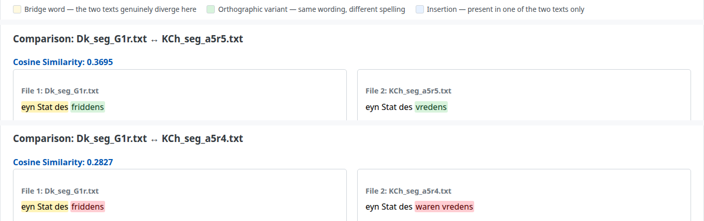

# FLAME: Formulaic Language Analysis in Medieval Expressions

[](https://doi.org/10.5281/zenodo.15805448)
[](https://opensource.org/licenses/Apache-2.0)

**FLAME** finds formulaic language and text reuse in historical corpora, especially medieval charters,
from the command line or a graphical interface. It matches variant forms of a phrase across scribal,
dialectal, and orthographic variation with leave-n-out (gapped) n-grams over a corpus-trained subword
vocabulary, and renders every match as an interactive side-by-side alignment.

<p align="center">
  
</p>

## Method

FLAME runs five stages in a fixed order. The full description is in [docs/METHOD.md](docs/METHOD.md), and the design rationale is in Kovács (in preparation).

**1. Character normalization.** Text is lower-cased, ligatures are expanded, and MUFI allographs (ſ→s, ꝛ→r, …) are mapped to base letters (Haugen 2009). An adaptive learner folds any other frequent out-of-alphabet character by its Unicode decomposition (é→e), controlled by `char_norm_alphabet` and `char_norm_min_freq`. Spelling and inflection are left alone unless the optional `bigram_normalization_enabled` and `phonetic_reduction_enabled` layers are switched on ([`Flame.load_corpus()`](flame.py#L664), [`AdaptiveAlphabet.learn_mappings()`](flame.py#L252)).

**2. Subword tokenization.** A BPE tokenizer (Sennrich et al. 2016) is trained on the normalized corpus. Its size is set by `-vocab_size`, either an integer or `auto`. With `auto`, the size is the number of frequent prefixes and suffixes that cover `vocab_coverage` of affix occurrences, plus 256 ([`suggest_vocab_size_optimized()`](flame.py#L69)).

**3. Gapped fingerprint.** Each window of `-ngram` tokens yields C(n, n − n_out) sub-grams, one for each way of dropping `-n_out` positions. Each sub-gram is hashed with a Rabin–Karp-style polynomial mod 2⁶¹ − 1 (Karp and Rabin 1987). A substituted, inserted, or deleted token breaks every contiguous n-gram that spans it, but at least one gapped sub-gram per affected window survives ([`Flame.leave_n_out_grams()`](flame.py#L958)).

**4. Similarity and threshold.** The fingerprints form a sparse document-by-feature matrix, which is TF-IDF weighted, and pairs are compared by cosine similarity. With `-similarity_threshold auto`, Otsu's method (Otsu 1979) on the non-zero scores proposes the cutoff, which suits bimodal score distributions; `-similarity_threshold <float>` sets it directly ([`Flame.compute_similarity_matrix()`](flame.py#L989)).

**5. Alignment report.** Each pair above the threshold is re-aligned on the original tokens with a Ratcliff–Obershelp matcher (Ratcliff and Metzener 1988). Each short gap is then classified as a bridge, an orthographic variant (`fuzz_threshold`), or an insertion, in the HTML report and in `linguistic_variations.tsv` ([`highlight_similarities()`](flame.py#L1339), [`classify_gap()`](flame.py#L1123)).

## Evaluation

The benchmark is the gold standard of Ostrowski (2024a, 2024b): two Ripuarian incunabula transcribed by HTR, the *Doernenkrantz van Collen* (Dk, 1490) and the *Koelhoffsche Chronik* (KCh, 1499). It has 23 Dk–KCh reuse pairs (13 literal, 6 weak literal, 4 non-literal), and 492 distractor segments (113 Dk, 379 KCh) are added; every Dk segment is compared with every KCh segment. Dataset: https://doi.org/10.5281/zenodo.13378221.

**Table 1.** Pair-level detection on the 19 literal and weak-literal pairs of the Ostrowski (2024) benchmark (492 distractors).

| System | P | R | F1 | pairs found |
|---|---|---|---|---|
| Passim (Ostrowski 2024) | 1.00 | 0.26 | 0.42 | 5 |
| BLAST (Ostrowski 2024) | 0.38 | 0.26 | 0.31 | 5 |
| TextPAIR (Ostrowski 2024) | 0.75 | 0.16 | 0.26 | 3 |
| FLAME (gapped fingerprint + TF-IDF) | 0.92 | 0.63 | 0.75 | 12 |

| FLAME, by gold set | P | R | F1 | pairs found / gold |
|---|---|---|---|---|
| 19 literal + weak-literal pairs (baseline-comparable subset) | 0.92 | 0.63 | 0.75 | 12 / 19 |
| all 23 pairs (incl. 4 non-literal, allusive) | 0.92 | 0.52 | 0.67 | 12 / 23 |

FLAME is reported at vocab 35, ngram 5, n_out 2, threshold 0.28, selected on the gold pairs (no held-out split); the baseline figures are Ostrowski's own, obtained as open retrieval, so the comparison is indicative. The four non-literal pairs (Regests 4, 21 with two pairs, and 22 in Ostrowski 2024c) reuse sense without sharing surface form, which a surface-and-subword method does not recover by design and which the baseline figures do not cover.

Full report (ablation, noise curves, threshold selection, run metadata): [benchmarks/ostrowski2024/README.md](benchmarks/ostrowski2024/README.md).


*Regest 13 (cosine 0.54).* Dk *Alle ouerschaff . is van gode* against KCh *Alle ouerschaff ind herschapie is van gode*: the two matching blocks are highlighted, and the inserted *ind herschapie* is marked as present in KCh only.


*Regest 5 (cosines 0.37 and 0.28).* Dk *friddens* against KCh *vredens* is marked as an orthographic variant (f/v and consonant doubling). Against KCh *waren vredens*, the divergent words are marked as a bridge.

## Key Features

- **Gapped (leave-n-out) n-grams** over BPE subwords, so a single variant word does not break a match.
- **Adaptive character normalization** with optional bigram and phonetic layers for dialectal material.
- **Corpus-derived BPE vocabulary size** (`-vocab_size auto`), with an automatic or fixed similarity threshold.
- **Two-corpus mode** (`input_path2`) to compare one collection against another.
- **Directories or glob patterns** as input; reports name files by their path relative to the input root.
- **Interactive HTML alignment** with bridges, orthographic variants, and insertions marked, plus a corpus-wide variants table.
- **Clustering** of related pairs into recurring legal formulas (see [Clustering](#clustering-recurring-legal-formulas)).
- **Optional auto-tune** of `ngram`/`n_out` on synthetic noise, and optional duplicate-file skipping.

## Installation

Requires Python 3.9 or newer and pip 26.1 or newer. A virtual environment is recommended.

```bash
git clone https://github.com/kreeedit/FLAME && cd FLAME
python -m venv venv && source venv/bin/activate   # Windows: venv\Scripts\activate
pip install -r requirements.txt
python -c "import nltk; nltk.download('punkt'); nltk.download('punkt_tab')"
```

A standalone GUI build without a Python environment: `pip install pyinstaller && pyinstaller FlameApp.spec` gives `dist/FlameApp/` (details in `docs/CLI.md`).

## Usage

### Graphical User Interface (GUI)

<p align="center">
  
</p>

Run `python flame_gui.py`. The window has three tabs: **Data & Core Setup** (corpus paths, window, threshold), **Normalization & Philology** (normalization layers, BPE vocabulary, gap and cluster thresholds), and **Auto-Tune & Outputs** (auto-tune, report switches, linkage, run button). The run log streams into the window, and each finished report opens from a button. The seven clustering internals (`core_*`, `min_duplicate_tokens`) have no GUI field and keep their defaults.

### Command-Line Interface (CLI)

Arguments take a **single leading dash** (`-input_path`, not `--input_path`), as `-param value` or `-param=value`. Booleans are **presence switches**: `-auto_tune` turns the option on whatever value follows it, so a `True`-default switch (the `gen_*` reports) cannot be turned off from the command line. Every parameter and its default: `python flame.py -h`, or the table in [docs/CLI.md](docs/CLI.md).

```bash
python flame.py -input_path ./texts                                   # one corpus, all defaults
python flame.py -input_path ./texts_a -input_path2 ./texts_b -similarity_threshold 0.30
python flame.py -input_path './fsdb/DE-LANRWR**/*.htr.txt' -similarity_threshold 0.60
```

### Input paths

`input_path` and `input_path2` take a **directory**, searched recursively for `file_suffix` (`.txt`), or a **glob pattern**, which alone decides which files are read. File lists are sorted, so runs are reproducible. Every report names a text by its path relative to the input root (`DE-LANRWR001/text.htr.txt`), so nested corpora that reuse one filename stay distinguishable. `**` is recursive only as a standalone path component.

## Outputs

A run writes up to six reports into the directory it was started from (which ones depends on the `gen_*` switches):

1. **`text_comparisons_XX.html`**: side-by-side alignments with cross-highlighted matches, a similarity filter, and a fuzzy slider. Gaps are marked as **bridge** (the texts diverge), **orthographic variant** (same wording, different spelling), or **insertion** (present on one side only). The earlier document is placed on the left when filenames carry a year.

   

2. **`similarity_heatmap.html`**: Plotly heatmap of the pairwise matrix, produced only below 2000 documents per side.
3. **`similarity_summary.tsv`**: per document, the related documents and the shared blocks longer than four words.
4. **`linguistic_variations.tsv`**: every classified gap of every reported pair (`Orthographic Variant`, `Insertion`, `Different Bridge Word`), with the same classification as the HTML.
5. **`clusters.html`** / **`clusters.tsv`**: the clustering report, one card and one row per recurring formula (see [Clustering](#clustering-recurring-legal-formulas)).
6. **`dist_mat.npz`**: the sparse similarity matrix. The GUI keeps it in its working directory; a CLI run deletes it with its temporary directory.

While `gen_clusters` is on (the default), `similarity_summary.tsv` and `linguistic_variations.tsv` carry a `ClusterID` column: second and third column respectively.
Scripts that read these files by position need updating; reading by header name is unaffected.
The full column lists are in `docs/CLUSTERING.md`.

## Clustering (recurring legal formulas)

Similarity says *which* charters resemble each other; clustering says *why*. For each reported pair, FLAME extracts the shared **core** by gapped local alignment (gaps up to `core_gap_tolerance` tokens) on spelling-folded tokens. Distinct cores are then merged when their edit similarity reaches `cluster_threshold`. The component is a port of the KONI clustering algorithm (see [Acknowledgements](#acknowledgements)).

A cluster reads as one of three things:

- **the same legal formula**: an arenga, a *corroboratio*, or a penalty clause recurring across unrelated documents;
- **the same legal transaction**: one act surviving in two or more copies or confirmations;
- **a shared chancery template**: a formulary in use by one scribe, notary, or office.

Two thresholds work together. `similarity_threshold` decides which pairs are compared at all, and `cluster_threshold` (default 0.70) decides which cores count as one formula. `cluster_linkage` picks the grouping: `louvain` (default) keeps a template whose members do not all match each other in one cluster, `clique` requires every member to match every other, and `union` chains transitively, as KONI does. Windows covering most of two charters are reported separately as near-duplicates (`min_duplicate_tokens`).

Anchoring the core on performative verbs (`core_anchors`) ships **off**, because the anchor set could not be derived from the corpus and has to be supplied per corpus. The measurements behind each default, the specificity score, and the anchoring experiments are in [docs/CLUSTERING.md](docs/CLUSTERING.md).

## Recipes

One-line starting points; the full parameter sets are in [docs/RECIPES.md](docs/RECIPES.md).

| Task | Command |
|---|---|
| Long, near-verbatim reuse | `python flame.py -input_path ./corpus -ngram 15 -n_out 1 -similarity_threshold 0.85 -vocab_size 8000 -vocab_min_word_freq 3 -char_norm_min_freq 2` |
| Rephrased or restructured text | `python flame.py -input_path ./corpus -ngram 10 -n_out 3 -similarity_threshold 0.60 -vocab_min_word_freq 3 -char_norm_min_freq 2` |
| Formulaic language, arengas | `python flame.py -input_path ./corpus` (defaults: ngram 6, n_out 1, automatic threshold) |
| Recurring legal formulas | defaults, plus optionally `-core_anchors=donau,contul,tradid` and `-min_core_specificity 10` |
| One series of a nested corpus | `python flame.py -input_path './fsdb/DE-LANRWR**/*.htr.txt'` |
| Short, HTR-noisy segments (the benchmark setting) | `python flame.py -input_path ./dk -input_path2 ./kch -min_text_length 15 -vocab_size 35 -ngram 5 -n_out 2 -char_norm_min_freq 2 -similarity_threshold 0.28` |

## Reproducibility

`python benchmarks/ostrowski2024/run_benchmark.py` regenerates every Evaluation number and records the git commit, the Python and package versions, the seed, and the dataset checksum in `results/run.json`. FLAME needs Python 3.9 or newer; the published results were produced with Python 3.12.3. `python flame.py -h` lists every parameter with its default, and a run is deterministic for a given corpus and parameter set. Changes are recorded in [CHANGELOG.md](CHANGELOG.md).

## Acknowledgements

The character normalization components build on principles found in **Anguelos Nicolaou's** library,
whose efficient character mapping was a valuable reference for this project.

The clustering component is a port of the clustering algorithm from the **KONI** project (Korpus
Nyelvtechnológiai Infrastruktúra), which groups literary formulas in Hungarian corpora. FLAME keeps
KONI's three-stage structure and its scoring metric, and re-targets it at the legal formulas of
medieval charters.

## Cite

Cite the concept DOI [10.5281/zenodo.15805448](https://doi.org/10.5281/zenodo.15805448), which
resolves to the latest release. To pin the exact code you ran, cite its version DOI instead:

| Version | Released | Version DOI |
| --- | --- | --- |
| 1.2.0 | 2026-10-19 | [10.5281/zenodo.23473940](https://doi.org/10.5281/zenodo.23473940) |
| 1.1.0 (Zenodo label `GIU`) | 2026-06-26 | [10.5281/zenodo.20932532](https://doi.org/10.5281/zenodo.20932532) |
| 1.0.0 | 2025-07-04 | [10.5281/zenodo.15805449](https://doi.org/10.5281/zenodo.15805449) |

`CITATION.cff` holds the same metadata, and GitHub's "Cite this repository" button reads it.

### APA Style

Kovács, T. (2026). *FLAME: Formulaic Language Analysis in Medieval Expressions* (Version 1.2.0) [Computer software]. Zenodo. https://doi.org/10.5281/zenodo.15805448

### BibTeX

```bibtex
@software{Kovacs_FLAME,
  author    = {Kovács, Tamás},
  title     = {{FLAME: Formulaic Language Analysis in Medieval Expressions}},
  version   = {1.2.0},
  publisher = {Zenodo},
  year      = {2026},
  doi       = {10.5281/zenodo.15805448},
  url       = {https://github.com/kreeedit/FLAME}
}
```

## References

Haugen, O. E. (Ed.) (2009). *MUFI Character Recommendation: Characters in the Official Unicode Standard and in the Private Use Area for Medieval Texts Written in the Latin Alphabet*, version 3.0. Bergen: Medieval Unicode Font Initiative.

Karp, R. M., & Rabin, M. O. (1987). Efficient randomized pattern-matching algorithms. *IBM Journal of Research and Development*, 31(2), 249–260. https://doi.org/10.1147/rd.312.0249

Kovács, T. (in preparation). Manuscript on FLAME, prepared for *Digital Scholarship in the Humanities*.

Ostrowski, A. (2024a). Ansätze und Tools für Historische Text Reuse Detection: Fragmentierter Text Reuse am Beispiel ripuarischer Inkunabeln des 15. Jahrhunderts. In *DHd 2024, Conference Abstracts*. Passau.

Ostrowski, A. (2024b). *Evaluation Set for Historical Text Reuse Detection*. Zenodo. https://doi.org/10.5281/zenodo.13378221

Ostrowski, A. (2024c). *Dokumentation von Parallelstellen zwischen dem 'Dornenkranz von Köln' und der 'Koelhoffschen Chronik'*. Zenodo. https://doi.org/10.5281/zenodo.14410766

Otsu, N. (1979). A threshold selection method from gray-level histograms. *IEEE Transactions on Systems, Man, and Cybernetics*, 9(1), 62–66.

Ratcliff, J. W., & Metzener, D. E. (1988). Pattern matching: The gestalt approach. *Dr. Dobb's Journal*, 13(7), 46–72.

Sennrich, R., Haddow, B., & Birch, A. (2016). Neural machine translation of rare words with subword units. In *Proceedings of the 54th Annual Meeting of the ACL (Volume 1: Long Papers)* (pp. 1715–1725).

## License

This project is licensed under the **Apache 2.0 License**.
